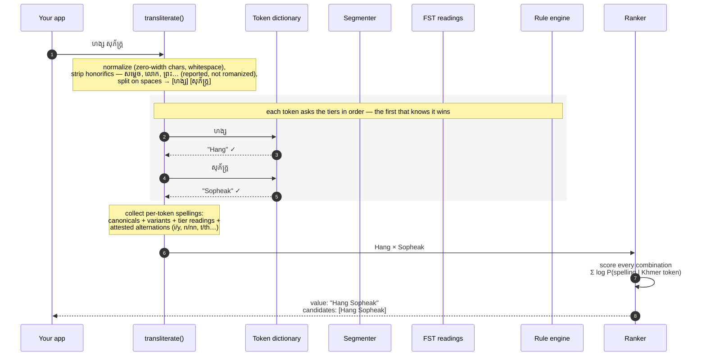

# khmer-name-romanizer

Khmer script → Latin transliteration for **Cambodian personal names** (passport/roster style romanization). Zero runtime dependencies. TypeScript.

**Accuracy, honestly tiered:** for a Cambodian name it has *never seen*, the first guess is the official spelling about **1 time in 4**, and the official spelling is in the top-5 candidates about **1 time in 3**. Names already in its dictionary do much better (97% on 72 famous names, 85% on curated name lists). ([How these are measured](#accuracy).)

```bash
npx khmer-name-romanizer "ហង្ស សុភ័ក្រ្ត"     # Hang Sopheak
npx khmer-name-romanizer --all "សូ បញ្ញា"     # So Panha | So Pagna
```

```ts
import { transliterateName } from 'khmer-name-romanizer'

transliterateName('ហង្ស សុភ័ក្រ្ត')   // "Hang Sopheak"
transliterateName('តាំងលាងខៃ')       // "Taing Leangkhai" (unspaced input is segmented)
```

## Why this library?

- **Khmer doesn't map character-by-character.** It's an abugida — subscripts stack, vowel signs wrap — so naive converters produce gibberish, and scholarly schemes (ALA-LC, ISO 11940) return diacritics no passport uses.
- **Romanization is one-to-many.** តាំង is Taing *and* Tang; សូ បញ្ញា is So Panha *and* So Pagna. A single-guess tool is wrong by construction — this library returns ranked `candidates`.
- **The only strong name-oriented engine** ([khmer-latin-name-transformer](https://pypi.org/project/khmer-latin-name-transformer/)) **is Python-only.** This one is pure TypeScript, synchronous, fully offline (names are PII — nothing leaves your process), and runs in browser, Node, and CLI.

### A suggestion engine, not an authority

Only the name owner knows their official spelling — no algorithm can know what a family declared at birth registration. So this library **suggests, recommends, and matches**; it never decides. Treat `value` and `candidates` as **pre-fills for a human decision** — never auto-write them onto an ID, diploma, bank record, or civil registry.

| Mode | Use it for |
|---|---|
| **Suggest** | Rosters, HR onboarding, registration forms, autofill — pre-fill ranked spellings; the person or registrar confirms |
| **Match** | KYC/fintech, people search & dedup — score whether a Khmer-script and a Latin-script name belong to the same person (rank against `candidates`, not just `value`; enable `flipOrderCandidates: true` for order-insensitive matching — Khmer writes the surname first) |
| **Display** | Readable Latin alongside Khmer for non-Khmer-reading staff; batch migration — propose candidates, flag low-confidence rows for review |

**Not for:** deciding anyone's official spelling, general prose transliteration, Sanskrit-derived regnal names (*-varman* kings), or foreign names written in Khmer.

## Pipeline

One real name flowing through the whole engine — `ហង្ស សុភ័ក្រ្ត`:



Tokens the dictionary doesn't know keep walking down the tiers — segmentation (longest-match DP split into known words), then FST readings, then the calibrated grapheme-level rules (`តាន់ ហុកហ៊ី` → `"Tan Hokhi"` rides exactly that cascade: dictionary hit for `តាន់`, rule fallback for the never-seen `ហុកហ៊ី`, ranked with `Hokhy`/`Tann` alternates).

The same walk as a compact reference:

```text
Khmer input
  │ 0. normalize      strip zero-width chars, ':' → ៈ, collapse whitespace
  │ 0b. strip         leading honorifics/titles removed (reported as `honorifics`)
  │ 1. tokenize       split on spaces → surname / given-name tokens
  │ 2. per token, first hit wins:
  │      a. tokenDict       1,471 learned Khmer → Latin word entries
  │      b. segmentation    longest-match DP splits unknown tokens into known words
  │      c. FST             optional pre-computed pynini readings, injected as a map
  │      d. rules           calibrated grapheme-level fallback (romanizeKhmer)
  │ 3. alternatives    per token: dictionary variants, FST/rule readings, spelling alternations
  │ 4. ranking         compose per-token options into ranked full-name candidates
  ▼
{ value, source, tokens, candidates }
```

- **Normalize & strip** — strip zero-width characters, map roster-typo `:` → ៈ, collapse whitespace. Leading honorifics/titles (ព្រះ, សម្តេច, ព្រះបាទ, លោក, អ្នកម្នាង, ឧកញ៉ា, ពញា…, royal compounds even when glued to the name) are not part of a personal name: they are removed before resolving and reported in an optional `honorifics` field — `សម្តេច ហ៊ុន សេន` → `"Hun Sen"` with `honorifics: ["សម្តេច"]`.
- **Tokenize** — space-separated surname/given-name tokens; unspaced input (តាំងលាងខៃ) is segmented against dictionary keys first.
- **Resolve each token**, strongest tier first: **token dictionary** (1,471 entries learned from verified bilingual rosters, well-known people, hand-verified pairs, and Wikidata mining; a hit returns the canonical `latin`, its `variants` lead the alternatives) → **segmentation** (longest-match DP, trusted only when every non-dictionary remainder is ≥ 3 characters) → **FST** (readings pre-computed with pynini, injected as a lookup map via `t.fstInputs()` — `createDefaultTransliterator` already injects the bundled distilled subset; the library stays pure and synchronous) → **rules** (`romanizeKhmer`, a grapheme-level fallback calibrated on the same rosters).
- **Alternatives & ranking** — each token collects spellings from dictionary `variants`, other tiers' readings, and attested alternations (nh/gn, t/th, n/nn, u/ou, i/y…); the composer scores every combination as **Σ log P(spelling | Khmer token)** and returns the top ones, deduped and capped at `maxCandidates` (default 5). Masses come from dictionary attestation counts; a reviewed canonical spelling carries extra trust (it is a human decision, not a frequency sample — corpus counts alone never demote it), rule/FST readings act as a smoothing prior, and unattested spellings get a small floor. The same scores are exposed as `scoredCandidates` for confidence thresholds in match workflows; constants are calibrated on the dev split + famous names only (`npm run` `scripts/calibrate-scoring.mjs`).

### Result shape

```ts
import { createTransliterator } from 'khmer-name-romanizer'

const t = createTransliterator({
    tokenDict: { ... },                        // extend the bundled dictionary
    fstResults: new Map([['ដារា', 'Dara']]),  // optional injected FST tier
})
const result = t.transliterate('តាំង ដារា')
// {
//   value: 'Taing Dara',                             // best spelling — always candidates[0]
//   source: 'tokens',                               // tokens | fst | rules (weakest token tier)
//   tokens: [...],                                  // per token: khmer, latin, source, alternatives[]
//   candidates: ['Taing Dara', 'Tang Dara', ...]    // ranked possibilities
//   scoredCandidates: [                             // same spellings, with scores
//     { value: 'Taing Dara', score: -0.92 }, ...     // Σ log P(spelling | token) — closer to 0 is likelier
//   ]
// }
```

The CLI prints candidates pipe-separated with `--all`.

### The optional FST tier

Tier 3 readings come from [khmer-latin-name-transformer](https://pypi.org/project/khmer-latin-name-transformer/) — a pynini FST, and the strongest grapheme-level engine for Cambodian names. It stays **optional and out-of-process**: this package has zero dependencies and never requires Python; callers who want the tier pre-compute readings and inject them.

```bash
# macOS ARM has no pynini wheels — build against brew openfst once:
brew install openfst
CPLUS_INCLUDE_PATH=$(brew --prefix openfst)/include \
LIBRARY_PATH=$(brew --prefix openfst)/lib \
pip install pynini khmer-latin-name-transformer

echo '["ហង្ស សុភ័ក្រ្ត"]' | npm run fst:readings   # -> scripts/fst-results.json
```

`fst:readings` expands the names via `t.fstInputs()` (whole names, tokens, and segmentation remainders), batches them through `scripts/khmer_to_latin.py` in one process (the model loads once), and writes a flat `{ khmer: latin }` map. Override the interpreter with `KHMER_TRANLIT_PYTHON` (e.g. a venv python).

```ts
import fst from './fst-results.json' with { type: 'json' }
const t = createDefaultTransliterator({ fstResults: new Map(Object.entries(fst)) })
```

Injected readings fill token gaps the dictionary and rules miss, and join `candidates` with prior-grade probability mass — they suggest, never override: dictionary canonicals still lead. Measured when the distilled tier was introduced: **+22 exact** on the shipped-dictionary eval (259 → 281) and +1 top-5 on the v1 lockbox at held exact ([accuracy report](docs/accuracy-report-2026-11.md)). The tier is the same one the student-management roster pipeline uses in production.

**Distilled subset — no Python needed.** `src/fst-distill-data.ts` bundles FST readings for **521 Khmer name tokens the dictionary doesn't cover** (dev-split cambodian + curated tokens, plus the Khmer-only tokens of the official parliamentary rosters — `scripts/sources/kh_parliament.json`, senators 1999–present; no official Latin exists for those names, so they are distill-scope only; regnal names excluded — out of scope, and the FST drops syllables there: ឥន្ទ្រវរ្ម័ន → "Vrm", filtered by a length guard). `createDefaultTransliterator` injects it automatically, still as prior-grade readings: corpus attestations outrank them, callers override per key with their own `fstResults`, and the leakage-free evals re-filter the map by eligibility recomputed from their own train rows (`distillMapFor` in `scripts/lib/corpus-tools.mjs`) so folds and the frozen split can never ride along. Regenerate after a corpus refresh with `node scripts/fst-distill.mjs` (needs the pip packages). Measured effect (v1 eval, before the 0.4.0 methodology fix): k-fold 199 → **205/835** exact (distillation 201 → parliament scope 205); lockbox mean 0.717 → **0.721** at identical exact (21/108).

**Syllable compositor — evaluated, not shipped.** A learned alternative for unknown tokens (syllable lexicon harvested from attested pairs, product-scored composition) was probed and rejected on evidence (`scripts/probe-syllable-compositor.mjs`, reproducible): it **loses to the rule engine as a single guess** (72 vs 76 exact on 248 leave-one-out composable tokens), so its readings could only ever ride below the rules; and the distilled FST already covers the same token population with better readings. Its residual value is top-5 recall on genuinely novel names — a +8.4pp ceiling (+61/726 rows) in the unseen-token scenario, roughly halved by candidate crowd-out — judged not worth a second generated lexicon and compositor tier. Revisit if the corpus grows several-fold.

**Segmentation upgrades — evaluated, none shipped.** The plan's final phase targeted the segmentation DP. Measured against the counterfactual pipeline (`scripts/probe-segmentation.mjs`): the DP already beats whole-token rules on trusted splits (18 vs 13 exact of 126); relaxing the remainder-trust rule gains nothing (0 of 87 untrusted tokens had a fully-dict-coverable split); n-best alternative splits rescue at most 3/102 misses (upper bound, in-sample). The dominant failure bucket is the 560 tokens with no dictionary prefix at all — a **vocabulary** problem (grow the corpus through `scrape:names` → `mine:tokens` → `merge:tokens` and re-distill), not an algorithm problem.

## Accuracy

Khmer romanization is one-to-many — តាំង is Taing *and* Tang; ប៉ែន is *Penn Nuth* the politician *and* *Pan Ron* the singer — so "accuracy" depends on what you measure. All numbers are reproducible (`npm run eval:kfold · eval:holdout · eval:famous · eval:scraped`):

| The name you type is… | Top-1 exact | Official spelling in top-5 |
|---|---|---|
| **Unseen — not in the dictionary (5-fold CV)** | **26%** (177/692, CI 23–29) | **34%** (CI 31–38) |
| Unseen — frozen lockbox, read once per release | 25% (32/129, CI 18–33) | 31% (40/129) |
| Already in the dictionary: famous people\* | 97% (70/72) | 97% |
| Already in the dictionary: curated name lists\* | 85% (132/156) | 93% (145/156) |
| Mixed corpus, shipped dictionary\* | 59% (499/848) | 67% (566/848) |

\* In-sample: scored on names the dictionary was built from (famous-name canonicals are hand-pinned). They show what to expect for names the dictionary already knows — not accuracy on new names.

Three things to know when reading those numbers:

- **Even misses are near-misses.** Mean similarity on unseen names is 0.74 — the engine returns `Penn Rorn` when the truth is `Pan Ron`, not gibberish. The dominant miss class (438 of 692 under CV) is *vocabulary the engine hasn't learned yet*, not wrong logic; that's what the [corpus loop](#the-optional-fst-tier) grows.
- **Top-5 is the working metric.** The library is a suggestion engine by design — it returns ranked `candidates` for a human to pick from. For KYC-style matching (order-insensitive, top-10, `flipOrderCandidates: true`) an unseen name is recognized **35%** of the time (CV, CI 32–39); names already in the dictionary, about 68%.
- **How "unseen" is measured.** Rows are grouped by person — every Khmer spelling of one person, or of one normalized name, stays on the same side of a split. Each fold rebuilds the dictionary without any entry the training rows alone would not have admitted. The repo owner's own spelling corrections are training data only and are never scored. A frozen lockbox (person-grouped, never mined, never tuned on) is read once per release. Known limit: alternative spellings can still leak through dictionary variants, so top-5 is slightly optimistic. Full methodology: [docs/accuracy-report-2026-11.md](docs/accuracy-report-2026-11.md).

When you know a person's official spelling, don't rely on any of the above — override it via `tokenDict` (see [Extending the dictionary](#extending-the-dictionary)).

Benchmark corpus: 2,887 scraped Khmer↔Latin pairs (Wikidata/Wikipedia + MIT/CC0 name lists + distilled name lists); 848 scored in-domain rows are Cambodian personal names, the rest are foreign names written in Khmer — out of scope by declaration (2% exact, reported for honesty).

## Extending the dictionary

The dictionary grows two ways — at runtime (no repo access needed) and by contributing verified pairs to the corpus (open an issue or PR with the Khmer spelling, the official Latin spelling, and a source).

```json
{ "តាំង": { "latin": "Tang", "count": 4, "variants": { "Taing": 2 } } }
```

`latin` is the canonical output; `variants` documents observed alternative spellings with frequencies. Pass merged data via `createTransliterator({ tokenDict })` or `createDefaultTransliterator({ tokenDict: yourOverrides })`.

## License

MIT © Hang Sopheak (ហង្ស សុភ័ក្រ្ត)
