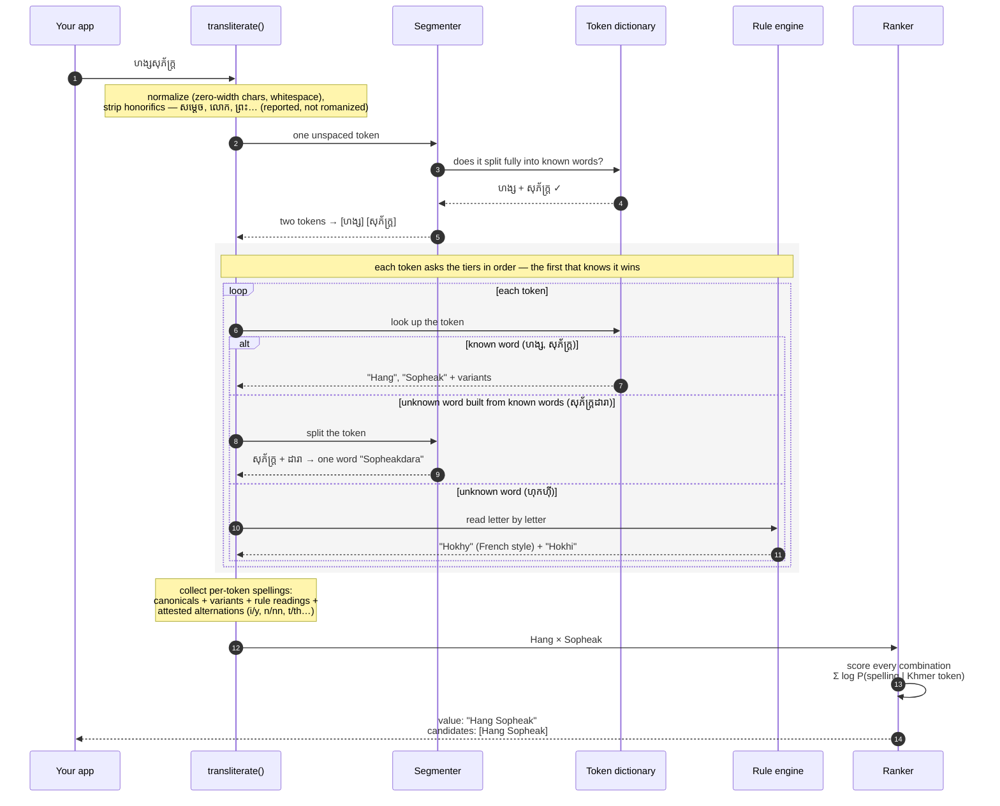

# khmer-name-romanizer

Turn **Cambodian personal names** in Khmer script into Latin spellings, the way passports and rosters write them. TypeScript, zero dependencies, fully offline.

**[Try it in your browser →](https://hangsopheak.github.io/khmer-name-romanizer/)**

```bash
npx khmer-name-romanizer "ហង្ស សុភ័ក្រ្ត"     # Hang Sopheak
npx khmer-name-romanizer --all "សូ បញ្ញា"     # So Panha | So Banha | So Pagna | Sou Panha | …
```

```ts
import { transliterateName } from 'khmer-name-romanizer'

transliterateName('ហង្ស សុភ័ក្រ្ត')   // "Hang Sopheak"
transliterateName('តាំងលាងខៃ')       // "Taing Leangkhai" (unspaced input is split for you)
```

**How accurate is it?** For popular names (well-known Cambodians), the first guess is the official spelling **97%** of the time. For names on curated name lists, 83%. For a name it has never seen, the first guess is right about **3 times in 10**, and the official spelling is in the top 5 almost **5 times in 10**. See [Accuracy](#accuracy).

## Why use it

- **Khmer does not map letter by letter.** Subscripts stack and vowels wrap around consonants, so simple converters give nonsense. Academic schemes (ALA-LC, ISO 11940) use accents no passport uses.
- **One name has many spellings.** តាំង is *Taing* and *Tang*. សូ បញ្ញា is *So Panha* and *So Pagna*. So the library returns a ranked list of `candidates`, not one answer.
- **Private and portable.** Names are personal data. Nothing leaves your process. It runs in the browser, in Node and as a CLI.

## Use cases

It suggests. It never decides. Only the person knows their official spelling, so a human confirms the output before it goes on an ID, diploma or registry record.

| Use case | How |
|---|---|
| **Form pre-fill** | Suggest the Latin name while the user types Khmer: enrolment, HR onboarding, registration. |
| **Name validation** | Check that a typed Latin name fits the Khmer name: KYC against the National ID, exam and diploma forms. |
| **Data-quality audit** | Scan records that hold both scripts and flag pairs that do not match (typos, wrong person). |
| **Dedup and record linkage** | Link a Khmer record to Latin records of the same person ("SO PAGNA", "Panha So"). |
| **Search** | "sopheak" finds សុភ័ក្រ្ត. |
| **Migration** | Propose Latin names for Khmer-only records. Send low scores to review. |
| **Display** | Readable Latin names for staff who do not read Khmer, or for SMS without Khmer fonts. |

**Not for:** general text, ancient royal names (*-varman* kings), or foreign names written in Khmer.

### Example: validate a typed name

```ts
import { createDefaultTransliterator } from 'khmer-name-romanizer'

const t = createDefaultTransliterator({ flipOrderCandidates: true, maxCandidates: 10 })
const norm = (s: string) => s.toLowerCase().replace(/[^a-z]+/g, ' ').trim()

const check = (khmer: string, latin: string) =>
    t.transliterate(khmer).scoredCandidates?.find((c) => norm(c.value) === norm(latin))?.score ?? null

check('ហង្ស សុភ័ក្រ្ត', 'HANG SOPHEAK')  // 0      match
check('ហង្ស សុភ័ក្រ្ត', 'Sopheak Hang')  // 0      match, given name first
check('សូ បញ្ញា', 'So Pagna')           // -3.18  match, less common spelling
check('ហង្ស សុភ័ក្រ្ត', 'Hang Dara')     // null   no match → send to review
```

A score far below 0 is a valid but rare spelling. `null` means "review", not "reject". Titles such as លោកស្រី are removed before matching and listed in `honorifics`.

## How it works

One name going through the engine, typed without a space: `ហង្សសុភ័ក្រ្ត`.



A token the dictionary does not know moves down to the next source. For `តាន់ ហុកហ៊ី`, the dictionary knows `តាន់`, and the rules read the new word `ហុកហ៊ី`, giving `"Tan Hokhy"` with `Hokhi` and `Tann` as alternatives.

### Result shape

```ts
import { createTransliterator } from 'khmer-name-romanizer'

const t = createTransliterator({
    tokenDict: { ... },                        // add your own entries
})

t.transliterate('តាំង ដារា')
// {
//   value: 'Taing Dara',                          // best guess, always candidates[0]
//   source: 'tokens',                             // tokens | rules (weakest source used)
//   tokens: [...],                                // per token: khmer, latin, source, alternatives
//   candidates: ['Taing Dara', 'Tang Dara', ...],
//   scoredCandidates: [{ value: 'Taing Dara', score: -0.45 }, ...]  // closer to 0 = more likely
// }
```

## Accuracy

| The name is… | Top-1 exact | Official spelling in top 5 |
|---|---|---|
| **Popular names** (well-known Cambodians) | **97%** | **97%** |
| In the dictionary: curated name lists | 83% | 93% |
| **Not in the dictionary** (5-fold CV) | **31.6%** | **49%** |
| Not in the dictionary (frozen lockbox) | 31% | 45% |

- **The bar is strict.** Most common Khmer name words have more than one official spelling (សែន is *Sen* and *Saen*). Even a perfect guesser matches the chosen spelling only about half the time on two-word names.
- **Misses are close.** It returns `Penn Rorn` when the truth is `Pan Ron`, not nonsense. Most misses are words it has not learned yet.
- **Top 5 is the useful number.** For order-insensitive KYC matching (top 10), it recognizes an unseen name 50% of the time.
- **French-style spellings by default** (Sareth, Chhay, Keo, Sophea, Taing, Khon, Borey). A native reader confirmed each convention. Use `romanizeKhmer(text, { plain: true })` for the plain reading.
- **Regnal and Pali names carry a Sanskrit reading too** (Mahendravarman, Kaundinya, Udayadityavarman) beside the Khmer one — kings and clerical names are transliterated from Sanskrit, not pronounced.

Reproduce with `npm run eval:kfold`, `eval:holdout`, `eval:famous` and `eval:scraped`.

## Adding names

If you know a person's official spelling, add it to the dictionary. You can do this at runtime:

```ts
createDefaultTransliterator({
    tokenDict: { 'តាំង': { latin: 'Tang', count: 4, variants: { Taing: 2 } } },
})
```

`latin` is the main spelling. `variants` lists other seen spellings with their counts.

To add names for everyone, open an issue or PR with the Khmer spelling, the official Latin spelling and a source. See [docs/adding-names.md](docs/adding-names.md).

## License

MIT © Hang Sopheak (ហង្ស សុភ័ក្រ្ត)
